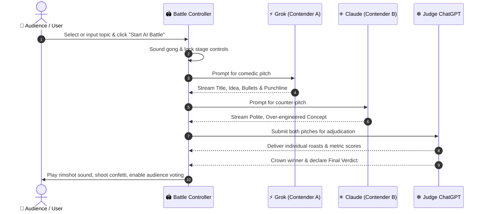

# 🎭 AI Comedy Coliseum — AI vs AI Roast Battle

> **Two generative jokers fight for comedic honor. One ruthless judge decides.**  
> An interactive, agentic comedy roast arena where AI personas face off with punchlines, pitches, and roasts in front of a critical LLM judge.

---

## 🌟 Overview

**AI Comedy Coliseum** is an arcade-style, interactive comedy arena designed for hackathons and live demos. It pits distinct generative AI archetypes against each other in real-time roast battles.

Users supply any absurd premise—or pick from curated comedy scenarios—and watch the contenders battle it out with distinct stylistic personalities before **Judge ChatGPT** delivers scathing critiques, multi-factor scoring, and an official final verdict.

---

## 🥊 The Arena Contenders & The Judge

| Persona | Role | Avatar / Style | Comedic Flavor |
| :--- | :--- | :--- | :--- |
| **Grok** | Contender A | ⚡ Neon Cyan (`/`) | **Chaotic & Edgy:** Zero filter, meme-heavy, unhinged ideas, rules are made to be incinerated. |
| **Claude** | Contender B | ✳ Neon Pink (`✳`) | **Polite & Overthinker:** Hypersensitive, deeply ethical, 4-page disclaimer footnotes, apologetic panic. |
| **Judge ChatGPT** | Supreme Judge | ❇ Emerald Green (`❇`) | **Exhausted Arbiter:** Strict, overworked tech professional trying to maintain sanity while scoring pure chaos. |

---

## ✨ Key Features

- **⚡ Real-time Battle Sequencer**:
  - Turn-based presentation with realistic typewriter streaming effects.
  - Structured comedic pitches: Title, narrative concept, 3 highlight bullets, and a punchline soundbite.
- **⚖️ Ruthless AI Deliberation**:
  - Independent roasts delivered to each contender.
  - Multi-criteria metric ratings:
    - Grok: *Funniness* & *Wildness*
    - Claude: *Funniness* & *Cleverness*
  - Animated score comparison bars (out of 20 points).
- **🔊 Pure Web Audio API Sound System (Zero External Audio Files)**:
  - Procedurally synthesized in-browser audio engine:
    - 🔔 Deep resonant battle gong / arena horns
    - 🥁 Classic comedic *"Ba-Dum-Tss"* rimshot (dual toms + brass-filtered white-noise cymbal)
    - 🎵 Victory fanfare arpeggios & interactive UI chirps
  - Built-in global SFX mute/unmute toggle.
- **🗳️ Audience Interaction & Live Scoreboard**:
  - Audience voting buttons (`Vote for Grok` / `Vote for Claude`).
  - Persistent session win counters with reset capabilities.
  - Confetti burst celebrations (`canvas-confetti`).
  - One-click **Copy Verdict** button for sharing battle results.
- **🎲 Curated Matchups & Dynamic Procedural Generator**:
  - Richly tailored default scenarios: *The Worst Restaurant Idea*, *Aggressive Morning Alarm Clocks*, *Awkward Office Team Building*, *Terrible Birthday Gifts*, and *Completely Useless Superpowers*.
  - Procedural dynamic template engine that automatically handles any custom user topic on the fly.
- **🚀 Zero-Config / Standalone Execution**:
  - 100% client-side single file application.
  - No build toolchains, node packages, or API key configurations required to experience the demo.

---

## 🕹️ Battle Sequence Workflow



---

## 🛠️ Tech Stack & Architecture

- **Core UI**: Pure HTML5 & Vanilla JavaScript (ES6+ async/await engine).
- **Styling**: [Tailwind CSS](https://tailwindcss.com/) via CDN with custom neon cyberpunk palette, arcade grid overlay, and keyframe glow animations.
- **Iconography**: [Lucide Icons](https://lucide.dev/).
- **Celebration Effects**: [Canvas Confetti](https://github.com/catdad/canvas-confetti).
- **Audio Synthesis**: Native HTML5 **Web Audio API** (`AudioContext`, `OscillatorNode`, `BiquadFilterNode`, `GainNode`, buffer-generated white noise).

---

## 🚀 Getting Started

Because the application is fully self-contained in a single file, setup takes under 10 seconds:

### Option 1: Direct Browser Launch
Simply double-click or open [ai_comedy_coliseum.html](file:///c:/Users/Lantern/Desktop/hackathon/ai_comedy_coliseum.html) directly in any modern web browser (Chrome, Edge, Firefox, Brave, Safari).

### Option 2: Local HTTP Server (Optional)
If you prefer serving via local HTTP:

```bash
# Using Python 3
python -m http.server 3000

# Using Node.js npx
npx serve .
```
Then navigate to `http://localhost:3000/ai_comedy_coliseum.html`.

---

## 🎮 How to Play

1. **Pick or Enter a Topic**:
   - Click one of the quick preset pills (e.g., *🍕 The Worst Restaurant Idea*).
   - Or click **Pick For Me** for a random scenario.
   - Or type any bizarre concept in the text input box.
2. **Launch the Showdown**:
   - Press <kbd>Enter</kbd> or click **⚡ Start AI Battle**.
3. **Listen & Enjoy the Show**:
   - Watch Grok and Claude stream their comedic pitches.
   - Read ChatGPT's biting critique and metric breakdown.
4. **Cast Your Vote**:
   - Disagree with the judge? Click **Vote for Grok** or **Vote for Claude** to reward your favorite contender on the live scoreboard!
5. **Hit the Drum**:
   - Click **🥁 Ba-Dum-Tss!** anytime to punctuate a joke with a synthesized drum roll and cymbal crash.

---

## 🔮 Future Enhancements / Roadmap

- [ ] **Live LLM API Mode**: Add an optional toggle to plug in live Gemini, OpenAI, or Anthropic API keys for real-time model completions alongside the procedural engine.
- [ ] **Voice Synthesis**: Integrate the Web Speech API (TTS) to have each persona voiced with distinctive pitch, speed, and accents.
- [ ] **Custom Fighter Creator**: Allow users to customize new fighter archetypes (e.g., *Boomer Bot*, *Cryptobro AI*, *Existential Doomer*).
- [ ] **Multiplayer Crowd Voting**: WebSocket room integration for hackathon audience live polling from mobile devices.

---

## 📄 License

Created for hackathon demonstration. Feel free to fork, expand, and remix under the [MIT License](https://opensource.org/licenses/MIT).
